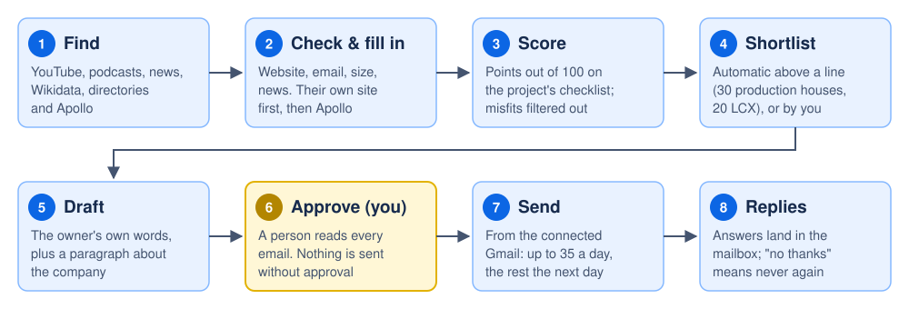
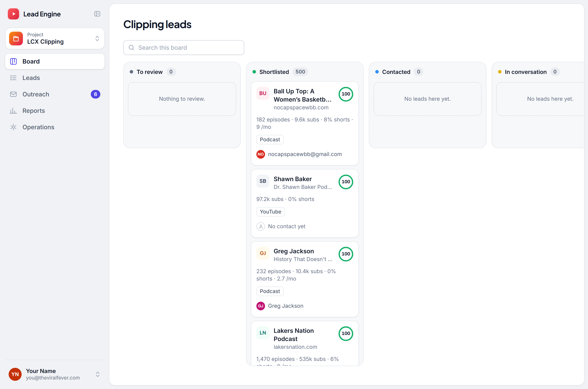
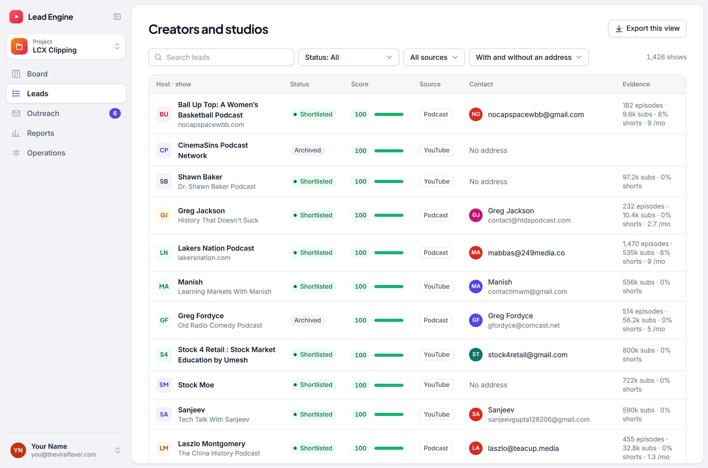
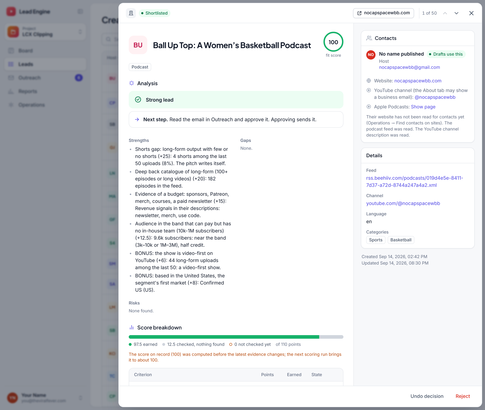
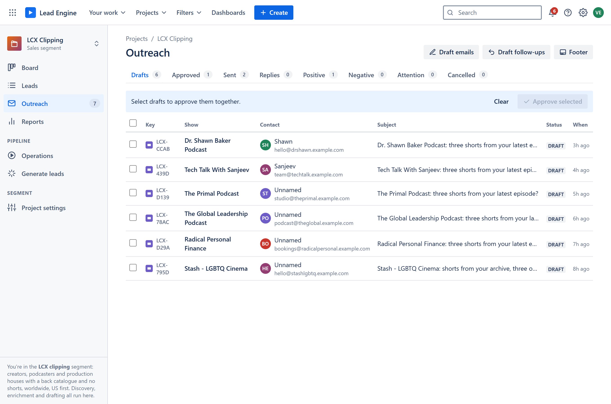
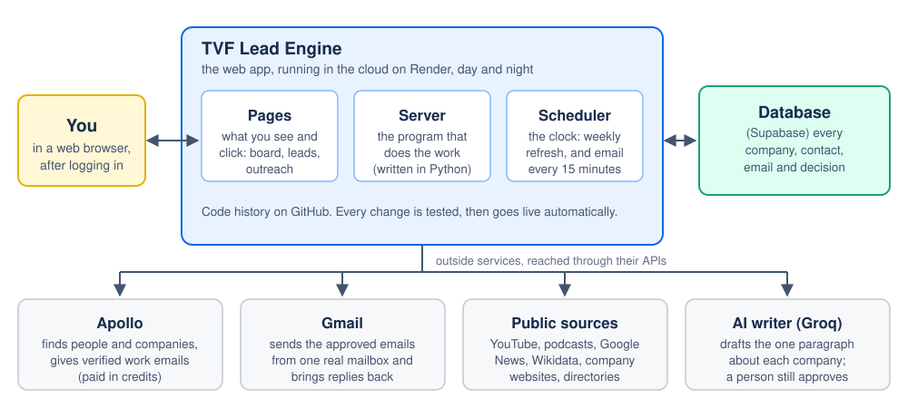

# What it does

**The TVF Lead Engine finds companies worth talking to, works out who to write
to, and drafts the email. A person approves every email before it goes out.**

Without it, someone would have to search the web for companies, check whether
each one is a fit, find the right person's email address, write to them one by
one, and keep track of who replied. The engine does all of that legwork, every
week, on its own. People make the two decisions that matter: which companies to
pursue, and which emails are allowed to go out.

It runs four separate projects, each with its own sources, checklist and email
wording:

| Project | Who it looks for | Why |
|---|---|---|
| **US Production Houses** | Independent US film and TV production companies | Co-productions, format and IP partnerships with TVF |
| **LCX Clipping** | Podcasts and YouTube creators with long videos and few short ones | Selling LCX's service of cutting long videos into short clips |
| **Startup Acquisitions** | Indian startups in the news for layoffs, shutdowns or rescue rounds | Spotting companies that may be open to an acquisition |
| **Universal** | Anyone you search for in Apollo | A free-form search: any segment, any place |

**Where it stands today (21 September 2026):**

- **2,841 companies and creators found:** 865 production houses, 1,657 shows
  and creators, 319 startups.
- **1,785 people and email addresses on file.**
- **66 production-house emails drafted** and waiting for approval, sent from
  vedanshg@theviralfever.com once approved.
- Sending is switched on for US Production Houses only, up to **35 emails a
  day**. The other projects are paused for now.
- **2,483 Apollo credits left** this month, out of 2,500.

# How a lead travels

Every lead goes through the same eight steps. The engine does the blue ones by
itself. The yellow one is always a person.

## 1. Find

The engine looks in public places where the right kind of company shows up:

- **Wikidata**, the free database behind Wikipedia: 342 production houses that
  list an official website.
- **The AICP directory** of US commercial production companies: 247.
- **Google News headlines** about format deals, co-productions and series
  orders: 143 production houses and all 319 startups.
- **YouTube and Apple Podcasts:** channels and shows, with their audience size
  and how often they post.
- **Apollo**, a paid business database of people and companies, when you
  search it yourself in the Universal project.

- **A person**, when they find a lead on their own: **Add a lead** on the Leads
  page takes its project, who it is, who the email goes to and the email they
  wrote, and approving it adds the lead and sends the email the usual way.

When the same company turns up in two places, it becomes **one lead, not two**.
The engine matches it by website, then by name, and keeps what each source
said about it.

## 2. Check and fill in

A name alone is not much use, so the engine fills in what is missing:

- **The website**, if the source did not give one.
- **Who to write to.** It reads the company's own website first, the contact
  page and the team page. This is free, and it respects each site's rules
  (robots.txt). For production houses scoring above 22.5 that still have
  nobody to write to, it then asks Apollo for the best person's verified work
  email, which costs one credit per person found.
- **Evidence for the score:** team size, what kind of work they make, whether
  they invite partnerships, and any news about deals.

## 3. Score

Each project has a **checklist**, and each item on it is worth points. For
production houses:

| What it checks | Points |
|---|---|
| Has adapted or co-produced international shows or formats | 30 |
| Has a live relationship with a streamer, network or big platform | 20 |
| The right size: a lean team of about 2 to 20 people | 20 |
| Makes the kind of stories TVF makes (comedy, slice-of-life, young adult) | 15 |
| Is open to collaborating: says so, or has a co-production record | 15 |
| A named decision-maker we can reach by email | 10 |

The total becomes a **score out of 100**. A few things take points off, such as
a portfolio full of advertising work for brands. Some things rule a company out
completely: it is not in the US, it is a major studio, or it has stopped
operating.

Every lead shows **why it scored what it did**: its strengths, what is still
unknown, any risks, and the next step. Nothing is a black box.

## 4. Shortlist

A shortlisted lead is one worth writing to. Above a set line this happens by
itself: **above 30 for production houses** and above 20 for LCX. Leads between
25 and 30 wait for a person to decide. If you reject a lead, it never comes back,
whichever source finds it again.

## 5. Draft

For every shortlisted lead with an address, the engine writes an email. It uses
the project's approved wording (for production houses, **the owner's own sample
emails, word for word**) and adds one paragraph about that particular company,
written from what the company says about itself on its own website. Production-house emails come from Vedansh, writing on Kartikeya's
behalf, and end with the company's postal address and a one-line way to opt
out.

## 6. Approve (always a person)

**Nothing is sent until a person has read that exact email and pressed
Approve.** This is the one gate that every email must pass. You can edit a draft
before approving it.

## 7. Send

Approved emails go out from a real Gmail mailbox, **at most 35 a day** for
production houses, each **at its own minute between 10:00 and 10:30 on the
recipient's clock**, Monday to Friday (the owner, 12 October: "some must be
going at 10:17 some at 10:13"). The minute is drawn when the email is approved,
and the Outreach page shows it as *Goes out*: "Tue 14 Oct, 10:17 New York time
(19:47 IST)". Approve more than a window or a day holds and the rest go in the
next weekday's window; one whose window passes unsent moves to the next at a new
minute, never later the same day. The top of the Outreach page shows how many
have gone out today, and the approved ones by the day each goes.

## 8. Replies

Replies land in the same mailbox, and the engine records them against the
lead. Anyone who replies "no thanks" is never written to again.

# What you see

The app is a website with a login. It has the same five pages in every project:

- **Board:** leads as cards in columns: to review, shortlisted, contacted, in
  conversation.
- **Leads:** the same leads as a list, with filters (status, source, "has an
  address") and a download to Excel.
- **Outreach:** drafts, approved emails, sent emails and replies, with a counter
  showing how many emails went out today.
- **Reports:** how many were found, shortlisted, contacted and replied.
- **Operations:** when the engine last ran and whether anything went wrong.

The Universal project has one more page: a search of Apollo, where you type a
segment and a place, such as *US arcades*, and save the companies or people you
want.

<figure><figcaption>The board: each column is a stage, each card a lead.</figcaption></figure>
<figure><figcaption>The leads list, with its filters and the Excel download.</figcaption></figure>
<figure><figcaption>A lead: its score explained point by point, and who to write to.</figcaption></figure>
<figure><figcaption>Outreach: drafts waiting for approval.</figcaption></figure>

# How it is built

The engine is a few parts that work together. None of them needs anyone's
computer to be switched on.

**The web app** is the program itself. It runs on **Render**, a company that
rents out computers in the cloud, so it is on 24 hours a day at
tvf-lead-engine.onrender.com. It has two halves:

- **The pages** are what your browser shows: the board, the lists and the
  buttons.
- **The server** is the part that does the work: searching, scoring, drafting
  and sending. It is written in **Python**, a common programming language.

**The scheduler** is a clock inside the server. Once a week it runs the full
refresh for each project: production houses on Tuesday at 7:30 am India time,
LCX on Wednesday, startups on Thursday. Every 15 minutes it drafts emails for
newly shortlisted leads. Each approved email goes out at its own minute between
10:00 and 10:30 on its recipient's clock, Monday to Friday: a second clock in
the server looks every few seconds for the next one due.

**The database** is **Supabase**. It is where everything is kept: every company,
person, email, score and decision. Think of it as a set of very large, very fast
spreadsheets that the app reads and writes.

**Outside services** are other companies' systems that the engine talks to
through their **APIs**. An API is a doorway one program uses to ask another for
something. Each one needs a key, which is like a password for a program:

- **Apollo:** people and companies, and verified work emails.
- **Gmail:** sending the approved emails and collecting replies.
- **YouTube, Apple Podcasts, Google News, Wikidata:** the public sources.
- **Groq:** an AI model that writes the one paragraph about each company. A
  person still reads and approves every email.

**Keys and passwords are never written into the code.** They are stored in
Render's private settings (called environment variables) and in a private file
on the laptop that is never shared.

**Settings, not code.** Each project has a settings file: the checklist and its
points, the shortlisting line, the email wording and the daily limit. Changing
a number there changes how the engine behaves, without rewriting the program.

**Changes are safe to make.** Every version of the code is kept on **GitHub**,
so any change can be seen and undone. Before a change goes live, automatic tests
check that the important behaviour still holds; there are hundreds of these
checks. Once a change is saved to GitHub, Render puts it live within a few
minutes.

**How Gmail is connected.** Vedansh signed in to Google once and clicked
**Allow**. Google then gave the app a **token**. It works like a valet key: the
app can send email and read replies in that one mailbox, but it never sees the
password, and the access can be withdrawn at any time from the Google account.

**Why emails reach the inbox.** Email providers check that a message really
comes from the domain it claims to. theviralfever.com has two of the three
standard proofs set up (called SPF and DKIM). This is why sending is from a
theviralfever.com address, and why adding the third proof (DMARC) is on the
to-do list.

# The rules that keep it safe

These rules are built into the database itself, not just the screens, so they
hold even if something else goes wrong:

- **No email goes out unless it was approved**, by a person or by an assistant
  using a key that person allowed to approve. Either way it is recorded against
  them. There is no "approve all without reading".
- **One conversation per company, ever.** Production houses get one email. LCX
  gets one email and one follow-up (four days later) in the same thread, and any
  reply stops the follow-up.
- **A rejected lead never comes back**, whichever source finds it again.
- **"No thanks" is permanent.** That company is never written to again.
- **Nothing is claimed that the evidence does not support.** Every sentence
  about a company comes from what was actually found about it.
- **Only public information, politely gathered.** Only public pages are read,
  and websites' robots.txt rules are respected. There is no LinkedIn scraping
  and no bought email lists.
- **Paid credits are spent only where the owner switched them on**, for
  production houses scoring above 22.5. Searching is free.
- **Sending stays gentle:** at most 35 a day from one mailbox, well below
  Gmail's own limit of 2,000, because a mailbox that sends too many cold emails
  gets treated as spam.

# Tech words, explained simply

| Word | What it means here |
|---|---|
| **Web app** | A program you use through a web browser instead of installing it. |
| **Server** | The computer, and the program on it, that does the work behind the pages. |
| **Cloud / hosting (Render)** | Renting a computer that is always on, instead of using our own. |
| **Database (Supabase)** | Where all the information is kept, organised in tables of rows. |
| **API** | The doorway one program uses to ask another program for something. |
| **API key** | A password that lets our program use another company's API. |
| **Environment variables** | The safe place on the server where keys are kept, out of the code. |
| **Scheduler** | The built-in clock that starts jobs at set times, like the weekly refresh. |
| **Pipeline** | A fixed series of steps run in order: find, check, score, and so on. |
| **Enrichment** | Filling in facts a lead is missing: website, email, size, news. |
| **Scraping (polite)** | Reading a company's own public web pages for details like a contact address, while obeying the site's rules. |
| **Score / rubric** | The checklist a lead is marked against, and the points it earns. |
| **Credits (Apollo)** | Apollo's currency: 1 credit for each verified email revealed, 1 for each page of company results. |
| **OAuth / token** | Google's way of letting the app send from a mailbox without ever knowing its password. |
| **SPF, DKIM, DMARC** | Three records on a domain that prove its emails are genuine. They help mail land in the inbox. |
| **AI model (Groq)** | A text-writing program that drafts one paragraph per email. A person approves every email. |
| **GitHub / commit** | The code's history. Each saved change is a commit, and any commit can be looked at or undone. |
| **Deploy** | Putting the latest version of the code live. Here it happens automatically. |
| **Test** | An automatic check that a behaviour still works, run before each change goes live. |
| **Daily cap** | The most emails a project may send in a day. |

# Where things stand, and what is next

**Ready now**

- 66 production-house emails are drafted, signed and waiting for approval.
- The footer (sign-off, postal address and opt-out line) is filled in.
- The Gmail mailbox vedanshg@theviralfever.com is connected on the laptop.
- Apollo is connected and finding contacts for good production houses on its
  own.

**To do before the first email goes out**

1. Add the four Gmail values to Render's private settings, so the server can
   send, not just the laptop.
2. Read and approve the drafts in Outreach.

**Worth doing soon**

- Add the DMARC record for theviralfever.com, so more email lands in the inbox.
- Start the production-house searches again. No new production houses have come
  in since late August, because those searches ran on the laptop. Moving them onto
  the server would make them weekly and automatic.
- Connect LCX's own sending mailboxes and lift its pause when that project is
  ready to start.
