# What this tool is

The Lead Engine finds companies and people worth emailing, gathers the evidence
for why they are worth emailing, scores them, writes a first email to each one,
and holds every email until a person reads it and says yes.

It sends nothing a person has not approved. That is the whole design.

There are two halves:

**The engine** runs on its own. It searches YouTube, Apple Podcasts, Wikidata
and news feeds, reads public pages, works out who is behind a show or a studio,
scores each one against a written rubric, and writes a draft email built from
that company's own numbers.

**You** do the part a machine should not do. You look at what it found, decide
yes or no, read the emails it wrote, and approve the ones you stand behind.

The whole flow is three steps. **Leads are shown** on the board. **You shortlist**
the good ones, and each one's email is drafted by itself within minutes. **You
approve** the email, and it is sent. A normal day is twenty minutes.

> The screenshots in this manual come from the real app, loaded with a snapshot
> of the live pool. The email addresses in them end in `example.com` because a
> manual gets shared and a real prospect's address does not belong in a PDF.


# Getting in

Open the site in any browser. You will be asked to log in.

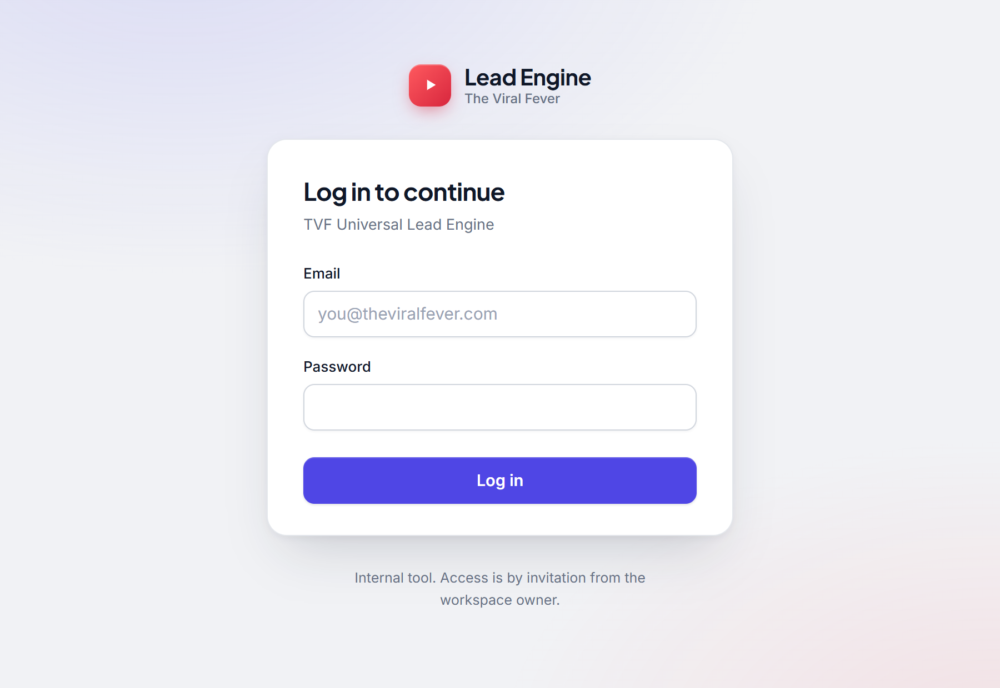{width=full}

**The first time anyone ever opens it**, the screen asks you to create the owner
account instead: an email address and a password of at least ten characters.
That account is created once and only once.

**One login per person.** Everyone has their own account, and the emails they
approve go out from their own Gmail, signed with their own name. To set people
up, the owner runs this once on their machine, with everyone's address:

```
python tools/users.py team suhasc@theviralfever.com kartikeyap@theviralfever.com upangyay@theviralfever.com
```

It asks for one **starting password**, twice, and never puts it in a command.
Tell each person the site address and that password. It works once: their first
sign-in asks for **their own password** (ten characters or more) and **their name
and title** (they sign every email that person approves). Until the starting
password is replaced, the app refuses to do anything else for that login. Adding
`--remove old@theviralfever.com` to the same command takes someone's login away;
their past approvals and sent emails stay in the history.

**Each person connects their own Gmail** in the app: account menu, **Your
Gmail**, **Connect your Gmail**. Google's own sign-in opens; they choose the
address they will send from and allow it (sending, and reading replies, for that
address only). They come back to Outreach with "Gmail connected", and the emails
they approve go out from it. Nobody's password is seen or kept. The same screen
connects a second address, connects one again when its sign-in stops working,
and disconnects one, which also withdraws Google's permission. An address already
linked to someone else is refused: one address, one person.

**Any Google email can be connected**, on any domain (TVF, LCX or another), and
in every project the emails a person approves go out from the address they
connected. It has to be a Google account (Gmail or Google Workspace): an
address that is only a "Send mail as" alias inside another Gmail cannot be
signed in to on its own.

The owner can still link an address for someone from their own machine:

```
python tools/users.py gmail suhasc@theviralfever.com
```

A browser opens on Google's sign-in; sign in to the address that person will
send from. `--move` moves an address to another person; `gmail-remove <address>`
unlinks one.

`users.py list` shows who has access, whether they have signed in yet and which
addresses they send from; `add` and `passwd` (with `--starting` for a one-time
password) do the same as `team` for one person.

**Your account** is at the bottom of the sidebar, under your name. Click it for
**Your Gmail** (where your emails go out from, today's count, connect or disconnect),
**Your name and title** and **Change password**. Changing your password keeps you
signed in where you are and signs you out everywhere else.

There is no "sign up" link and no password reset by email. That is deliberate.
Everything in this tool sits behind that one login, including every screen,
every number and every draft email.


# The shape of the app

Down the left is the menu. Five places, and you will live in three of them.

| Where | What it is for |
|---|---|
| **Board** | The pipeline at a glance. Cards move left to right as you decide on them. |
| **Leads** | Every lead, whatever its status, with search and filters. Better than the board once you have hundreds. |
| **Outreach** | Every email. Drafts waiting for you, approved ones, sent ones, and replies. |
| **Reports** | Where every company sits. Are we contacting enough? Are they replying? |
| **Operations** | Run the weekly refresh by hand, see what runs by itself and how it went, check the mailboxes. |

The number next to **Outreach** is what is waiting for you there: drafts to
approve, replies nobody has marked yet, and sends that failed.

At the top of the sidebar is the Lead Engine mark and, under it, the project you
are in. At the bottom is your account: your name, and behind it **Your sending
address**, **Your name and title**, **Change password** and **Log out**. The small
button beside the mark folds the sidebar down to a row of icons, and back. On a
phone the sidebar opens from the menu button at the top left. The app is light
or dark to match your computer's setting.

The Universal project has a different menu: **Apollo search** sits at the top,
because that is where its leads come from, then Board, Leads and Outreach (for
the emails you write to its leads). Reports and Operations are not there. LCX
Services has Apollo search at the top too, for adding a lead by hand, and every
other page after it.

## Switching between projects

A **project** (the code calls it a segment) is one sales motion with its own
leads, its own rubric, its own email templates and its own mailboxes. Nothing
leaks between them.

Click the project, just under the Lead Engine mark at the top of the sidebar,
to switch.

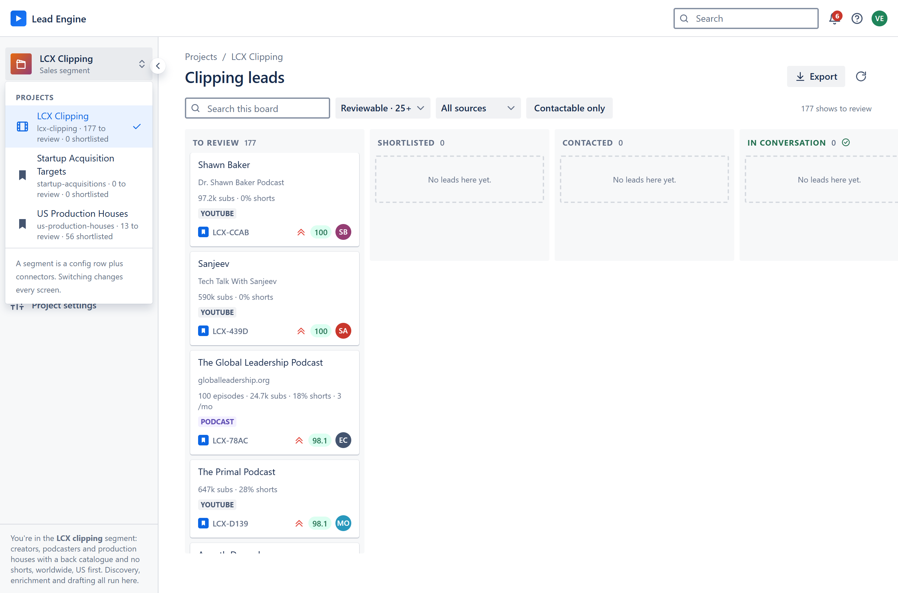{width=full}

Right now there are five:

- **LCX Clipping** — creators, podcasters and production houses with a deep back
  catalogue and almost no short-form. This is the active one.
- **US Production Houses** — TVF co-production targets.
- **Startup Acquisitions** — Mumbai startups showing public signs of struggle,
  which TVF could buy for little or back with its content and audience.
- **Universal** — any company or person, found with Apollo. No rubric and no
  harvest: you search, you pick, you save.
- **LCX Services** — companies and businesses everywhere cold email is
  allowed, found by itself every Friday and sent one email offering every LCX
  service, with the services deck attached.

Whichever project you pick, every screen changes with it. The board, the leads,
the emails, the reports. Check the sidebar if you are ever unsure which one you
are looking at.


# Universal: searching Apollo

The Universal project finds leads anywhere, through Apollo. Pick it from the
project menu and it opens on **Apollo search**.

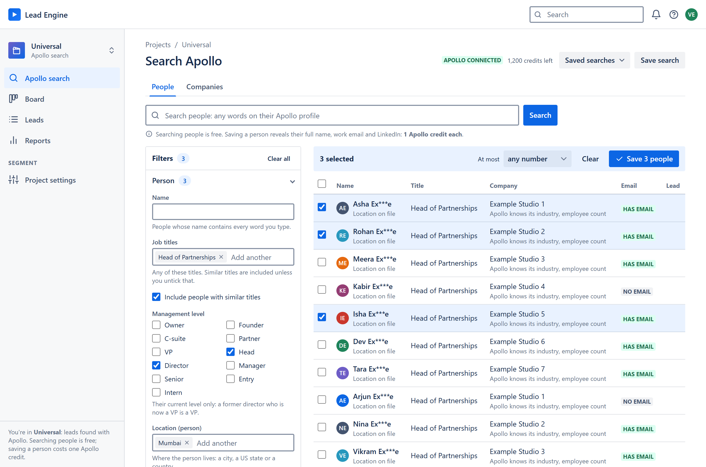{width=full}

**Two searches, as in Apollo's own app.** *People* finds people; *Companies*
finds companies. Type in the search bar, or set filters on the left, then press
**Search**.

**The search bar reads what they do and where.** Type a segment, the way you
would say it: *US arcades*, *animation studios in California*, *Atlanta-based
arcades*, *Indian production houses*. The place becomes the HQ location filter
(a country, a nationality like "Indian", a US state, a city, or anything after
"in"), and the rest becomes Apollo's industry and keyword tags, searched in both
singular and plural. Commas or "or" search several segments at once (*arcades,
bowling alleys*).

**In a people search, say the job too:** *producers at animation studios in
California*, *heads of partnerships at production companies*, *founders of gaming
startups in India*. The job becomes Apollo's job-title filter (similar titles
included), what the company does becomes the same company tags as above, and the
place is the employer's HQ. Until 21 September the words went to profile
keywords, which matched company names: *producers in California* found staff at a
food firm called Flavor Producers; read as a title it finds 36,594 producers.

**No job typed? You get the people who decide.** A people search that names no
job, like *UAE restaurants*, finds the owners, founders and C-suite of those
companies, not everyone on the payroll: 2,144 decision makers instead of 168,306
people, cost controllers and bar managers among them. The line under the bar says
so, with a **Search everyone instead** link. You can also type *everyone at UAE
restaurants*, or pick a job title or management level under Filters; either one
replaces the default.

**Typos are caught before they cost anything.** Apollo matches tags word for word,
so *UAE Restraunts* finds nothing, while *UAE restaurants* finds thousands. When a
word looks mistyped, a company search is not sent (no credit spent) and the page
asks: *Did you mean UAE Restaurants?*, with a link to search that, or to search
what you typed after all. A people search is free, so it runs and shows the same
suggestion if it finds nobody.
After each search, a line under the bar says exactly how it was read, for example
*Searched people titled "producer", at companies tagged "animation studios" or
"animation studio", based in California*. To find one company by its name, use
**Company name** under Filters.

The filters carry the names Apollo gives them:

- **Person**: name, job titles, management level, where they live, email
  status. Once you enter a job title, **Include people with similar titles**
  appears to widen it.
- **Company**: company name, HQ location (a company search can also leave
  locations out), number of employees, industry and keywords, revenue, company
  domains, and domains to leave out.
- **Technologies** the company uses, **funding**, **job postings**, and
  **headcount growth** over 6, 12 or 24 months.
- **Company**, in a people search: the companies you picked with **People
  here** (below).
- **Company lookalikes**, in a company search: press **Lookalikes** on a company
  to find others like it.

**What it costs.** Once Apollo is connected, the credits left show at the top
right. Until then, a box at the top of the page says it is not connected and
lists the steps.

| | Apollo credits |
|---|---|
| Searching people (25 a page) | none |
| Saving a person (reveals their name, work email and LinkedIn) | 1 each, only when Apollo finds them |
| One page of company results (100 companies) | 1 |
| Saving companies | none |

A page of companies costs one credit whatever its size, so a company search
always brings back a full page of 100. Saving people always asks first, and
says the most it can cost.

**Saving.** Tick the people or companies worth keeping and press **Save**. Each
company becomes a lead and each person a contact on it, on this project's Board
and Leads pages, where you shortlist or reject them as in any other project.
*At most N per company* stops one company filling the list. Nobody already saved
is paid for twice, and TVF's own people, and anything rejected before, are never
saved.

**People at a company.** In a company search, **People here** switches to a
free people search at that company. Tick several companies and press **Find
people at these companies** to do the same for all of them.

**Saved searches.** **Save search** keeps the search bar and every filter under
a name, and **Saved searches** runs one again. A saved company search waits for
you to press Search, because it costs a credit.

## Writing to Universal leads

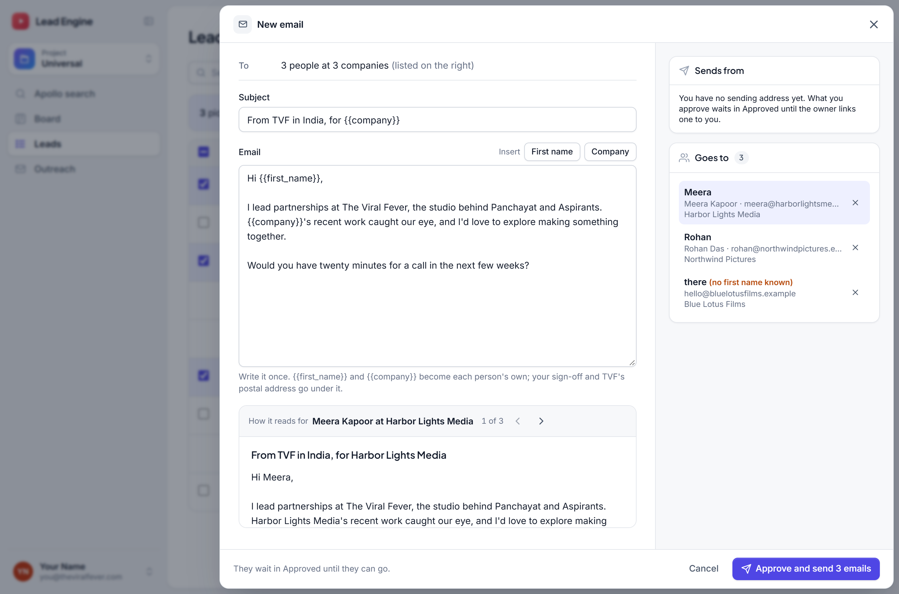{width=full}

Universal leads come from your searches, not from a harvest, so there is no
ready-made email for them. You write it. On the **Leads** page, tick the leads
you want to write to (a tick box shows on every lead with an address that has
not been written to yet), then press **Write email to N**. For one lead, open it
and press **Write email**.

Write the subject and the email once. Two fields make it each person's own:
**{{first_name}}**, the first name of the person it goes to ("there" when no
first name is known, so *Hi {{first_name}},* still reads), and **{{company}}**,
their company. The **First name** and **Company** buttons put them in for you.
Anything else in double braces is refused.

Under it, the page shows the email exactly as each person will read it, your
sign-off included; the arrows, or a click on a name in
the list on the right, go from one person to the next. The list shows how each
is greeted and says when no first name is known. Leave anyone out with the
cross beside their name. Leads that cannot be written to are listed with the
reason: no address, already contacted, rejected, or already written to. So is
an address that has already replied to us, or bounced an email from us, in any
project: whoever answered is answered in that conversation, never sent a second
cold email.

**Approve** approves every one of them: you have read it and stand behind it,
exactly as when approving a draft. Each goes on its own, at its own minute
between 10:00 and 10:30 on its recipient's clock (the list on the right shows
each person's window), from your own sending address, signed with your name and
title, inside that address's daily limit (see *When an email goes out*). A lead still in To
review is shortlisted by being written to. Every company gets one first email
and no more, as everywhere. The emails then sit in **Outreach** under Approved
until they go, then under Sent; replies arrive under Replies. Until the owner
links a sending address to you, they wait in Approved.


# LCX Services: every service in one email

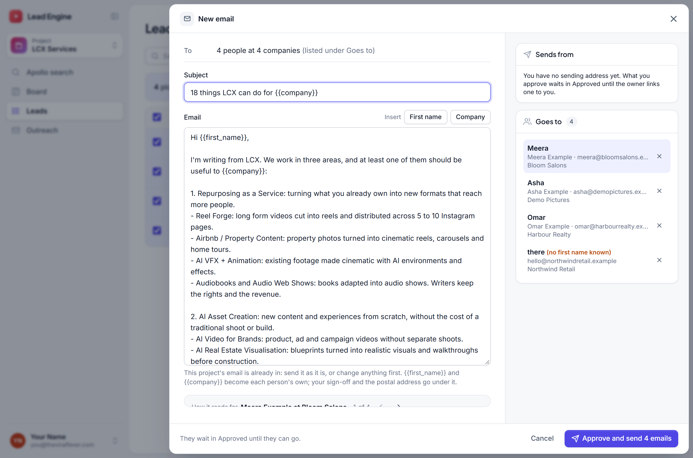{width=full}

LCX Services offers everything LCX does in one email, with the services deck
attached, to businesses it finds by itself. Like the production houses, it
harvests every Friday:

- **Companies from Apollo**: mid-size companies of any industry, consumer
  brands, retailers, real estate developers, hotels, publishers, insurers,
  schools, attractions and agencies in the US, the UK, India and the UAE. The
  ones showing a reason to buy now come first: hiring trainers, sales staff,
  store staff or content people this month, or funded in the last three months.
  The lead says which.
- **US banks from the FDIC's register**: banks of $1 to 20 billion, largest
  first.
- **Companies from Wikidata**: the same kinds of buyer and listed companies,
  each with its own website. The ones of 10 to 5,000 people come first;
  companies of over 50,000 are left out.
- **Local businesses from OpenStreetMap**, fewer than before: independent cafes,
  salons, gyms and shops that publish a website or an email address, two cities
  a week. A chain's branch is never one of them.

It looks everywhere cold business email is allowed, so Canada, Germany, Austria
and Italy are left out. A business that is already a lead of another project is
not found again here.

Each lead says what kind of buyer it is and which services to pitch first. Its
address comes from the business itself first: the one it publishes, or one read
off its own website. A lead that fits well and still has nobody to write to gets
the right person from Apollo: a marketing head at a brand, the head of training
at a mid-size company, the principal of a school. Only someone in a fitting role
who still works there is paid for, inside a weekly budget the owner set (120
credits), and only for a lead scoring over 60 whose own website has been read.

**How a lead is rated** (since 2026-10-07). Out of 100, on what the engine can
check for itself. Does its own website show it is the kind of buyer it was filed
as (30)? Is it the right size to buy and to answer (25)? Does it already post
video or Instagram (20)? How directly do the services fit it (15)? Is there
someone to write to (10)? A reason to buy now, such as hiring trainers, adds a
little, and so does being in the US, the UK, India or the UAE. A software firm,
staffing agency, competitor, university, charity or a company too big to answer
loses 50, and a website not in English loses 15. Sanctioned countries, adult,
gambling, tobacco and weapons businesses, very large companies and their brands,
and dead websites are left out. Anything not yet known is left out of the
rating, not counted as zero. A lead above 70 is shortlisted by itself, and its
email drafted within minutes, once its website has been read and it has someone
to write to; for a bank or a mid-size company, that must be a named person, not
an info@ inbox. Until then it waits in To review.

**One service per lead** (since 2026-10-13). Each lead is tagged with the ONE
service its email pitches, from what is known about it: a hiring signal first,
then what its own website or Wikidata says (it publishes books, sells homes
before they are built, is a school, runs stores with screens), then the kind of
business it is, and last the first service its audience is pitched. The **Leads**
and **Board** pages have a tab for each service with its count, plus **Check
service** (a person should pick one) and **Not a buyer**. Open a lead to see its
service and why; **Change service** picks another, and the engine never undoes
your pick. A draft waiting for approval that pitched something else is withdrawn
and written again.

**The email** puts their problem first: *Hello* and the person's first name with
*I trust you are well.* (or just *Hello,*), one sentence on a problem a business
like theirs usually has, how the one service solves it, who LCX is, with the deck
attached, and one small ask: *Would it be useful if I sent you a few examples?*
It never recites their numbers or achievements and never uses a dash. The
subject is the service's own, five words at most, such as *Less admin behind the
counter*. The two middle lines are written by Groq from the lead's own words,
or are the service's fixed lines when there is nothing of theirs to write from.
Each email records which service it pitched. It is signed with your name and
your title, then *LCX*; there is no postal address and no opt-out line. You
need a name and a title in your profile to approve. The deck goes with every
email: five pages, a cover, one page for each of the three clusters with every
service in the services sheet's own words, and the next step. Open it from
**Attached** on the email before you approve. Drafts written before 2026-10-13
in the old style are refused at approval until they are written again.

**Approving** is as in the other projects: in **Outreach**, under Drafts, open
an email and approve it, or tick several and approve them together after reading
a random few. It goes from your own sending address, inside its daily limit.
When the deck is rebuilt, emails not yet approved take the new one, and an
approved email whose deck changed since is held back rather than sent with a
file you did not see.

**Adding a lead by hand.** **Apollo search** works here as in Universal, and
what you save becomes an LCX Services lead, drafted like the others once it is
shortlisted. What a search costs here counts in the project's weekly budget, and
once that is used up the page says so until Friday.

A company that already had a first email from another project, or an inbox
that did, is not written to again from here: approving it says why. (A first
email that bounced does not count: it reached nobody.)


# The board

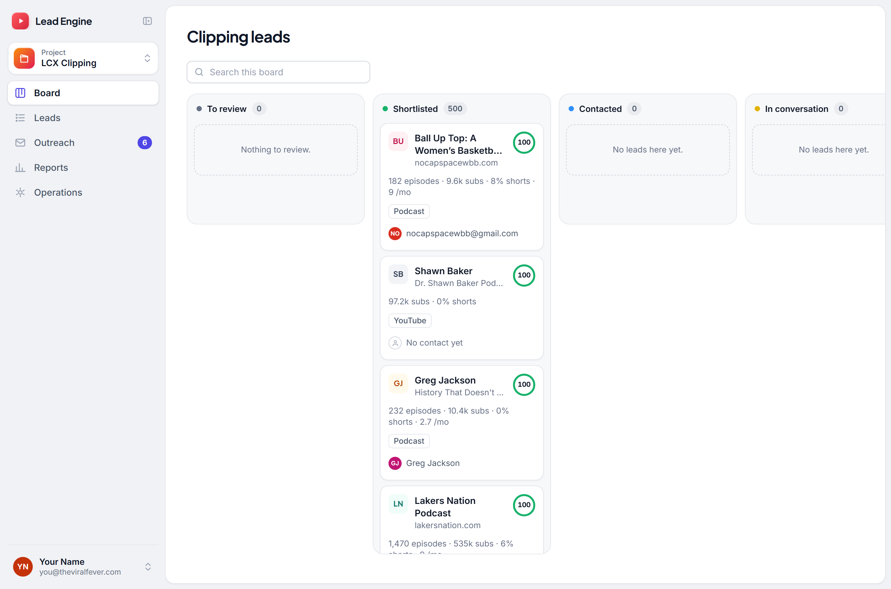{width=full}

Four columns, left to right. A lead only ever moves forward.

**To review** — the engine found it and scored it. Nobody has decided yet. This
is your inbox. It starts at the project's review line, 25 points; leads below
the line are still in Leads. In LCX Clipping everything above 20 is shortlisted
already, so To review shows every lead that is left, whatever its score, for
you to pick by hand. In US Production Houses everything above 30 is shortlisted
already, so To review holds the leads between 25 and 30.

**Shortlisted** — you said yes, or it scored above the project's automatic line
(20 in LCX Clipping, 30 in US Production Houses). It gets an email.

**Contacted** — an email has been sent. The engine will not start a second
thread with this company, ever.

**In conversation** — they replied and the reply was a real one. Your job now,
not the tool's.

A rejected lead leaves the board. To find one, open Leads and set Status to
Rejected.

In the Universal project the emails are the ones you write (see *Writing to
Universal leads*); its board has the same four columns.

Above the columns is one search box.

## Reading a card

Each card shows the person first when the engine could work out who is behind
the show, and the show or company underneath. Below that are the numbers that
made it interesting: subscribers, how much short-form it publishes, how many
episodes, how often. Then a few tags: which source found it (only in projects
with more than one source), the kind of lead, and the place.

Beside the name is the fit score, **out of 100**, as a ring that fills with it:
indigo from 25 (worth a look), green from 45 (the priority band). It is
explained in full inside the lead. On the bottom row is the person the email
goes to ("No contact yet" means there is no address yet) and, once an email has
gone, who reached out. Universal leads have no score.


# The leads list

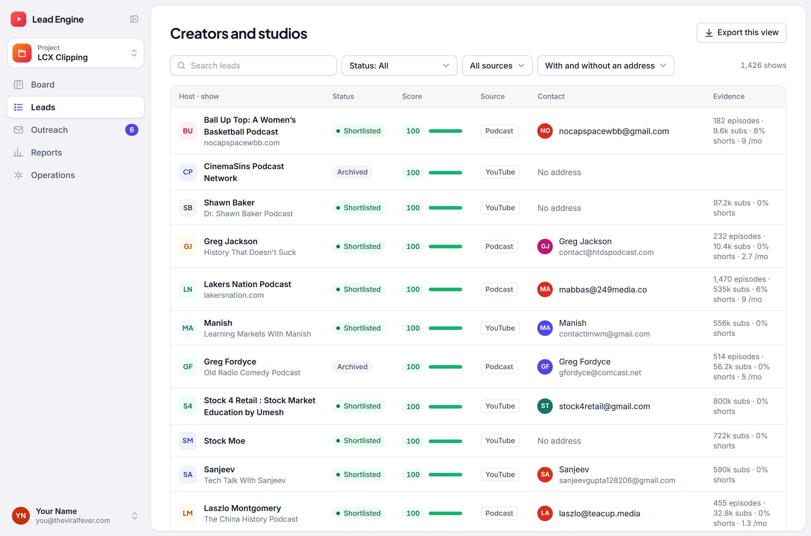{width=full}

The board is nice for twenty leads. Past that, use this. It is the whole pool:
every lead, whatever its status, best score first.

Search matches the show name, the host's name and the website. The filters along
the top narrow by status and, in projects with more than one source, by which
connector found it. A status is in the list only while some lead has it.

The **Contact** column shows the address a draft would actually use, with the
person's name when one is known. "No address" means there is none yet.

The last filter splits the list by exactly that: **Has an address** is what can
be written to today, **No address yet** is the work left, and each option
carries its own count. It uses the same test the drafting step makes, so a lead
in "Has an address" is a lead that can be drafted. It appears only when the
current selection holds some of each — filtering a list where every lead already
has an address would do nothing, so it stays out of the way.

**Export this view** downloads exactly what the list shows, search included, as
a spreadsheet named after the project. It is hidden when the list is empty.

Click anywhere on a row to open it.

## Adding a lead you found

Not every lead comes from the software. When you find one yourself (a company
someone mentioned, a show you came across, a card from an event), press
**Add a lead** at the top of the Leads page. One window holds all of it:

- **Project:** which of our projects it belongs to. The email then goes out the
  way that project's emails do. It starts on the project you are in.
- **The lead:** its name (a company, a show, a startup or a business, as the
  project calls it), and if you know them, its website, country and city. The
  country and city decide its clock, so the email lands between 10:00 and 10:30
  where they are.
- **Who it goes to:** the person's name, their role and their email address.
  The address is your word for it: Apollo never saw it, and it is allowed
  because you typed it.
- **LCX Services only:** the one service the email pitches. The deck its first
  emails carry goes with it, unless you untick it.
- **The email:** subject and text, written by you. **{{first_name}}** and
  **{{company}}** work as in Universal's Write email, the preview shows it as
  they will read it, and your sign-off goes under it. **Rewrite with AI** is
  there too.

The window checks as you type, and says plainly when something stops it:

- **The lead is already in the project:** it is used, never added twice. A
  draft the software wrote for it, and nobody approved, is replaced by yours.
- **It was rejected or archived:** the window says so, with the reason, and
  approving your email reopens it.
- **It is refused:** a lead already contacted or in conversation, an address or
  company that already has a first email from us in any project, one of our own
  addresses, TVF itself, or a country the project never emails (LCX: Canada,
  Germany, Austria and Italy, where cold business email needs consent first; LCX
  Services: countries it cannot be paid from).

**Approve** adds the lead and approves the email in one step. Nothing is kept
before that, and if the email cannot go, the lead is not added either. Then the
usual: it goes from your own Gmail, signed by you, copied to the project's CC
unless you switch that off. If nobody replies in four days, its follow-up waits
for approval in Follow-ups. The lead shows on the Leads page and the board, with
**Manual** as its source and who added it.


# Deciding on a lead

This is the main job. Click any row or card. The lead opens in a sheet beside
the list, so you never lose your place: **J** and **K**, or the arrows at its top
right, move to the next and previous lead in the same column or list without
closing it. **Esc**, or a click beside the sheet, closes it.

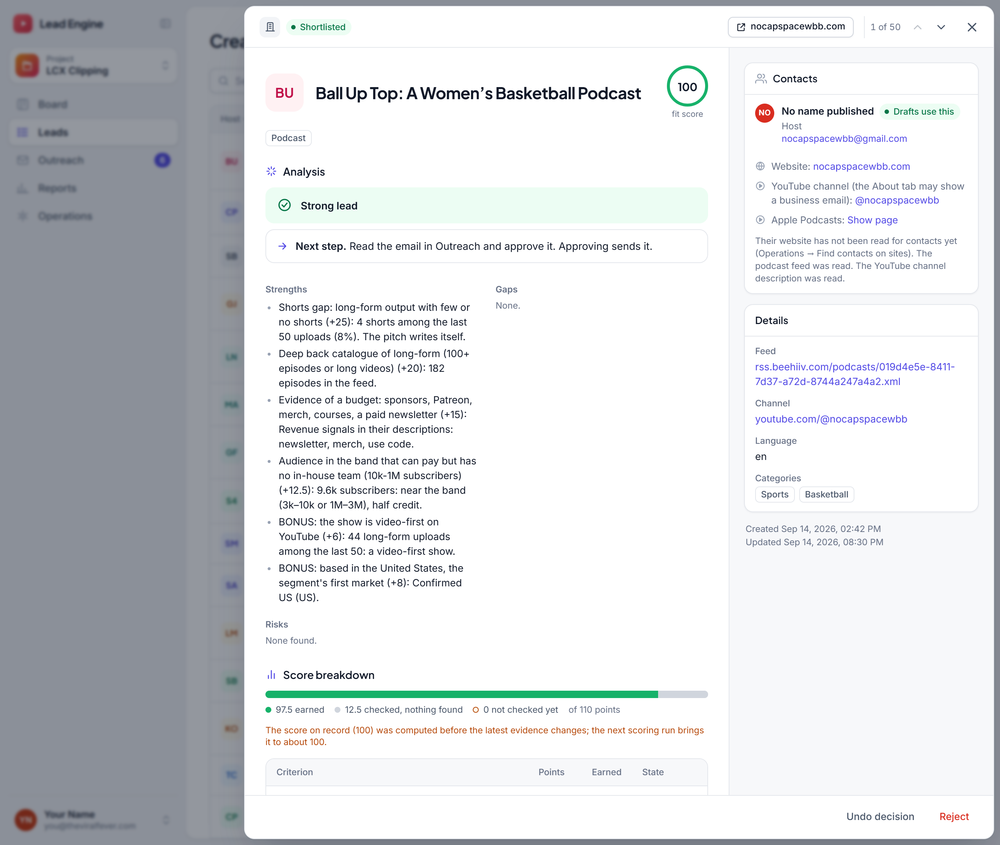{width=full}

At the top are the lead's status and a link to the company's website, labelled
with its domain; beside the name, its fit score.

Read it top to bottom:

**Analysis** comes first. One line gives the engine's verdict, such as "Strong
lead" or "Hold: no usable email address". Then one suggested next step, then
strengths and gaps, each naming the criterion and its points (the reasons are in
the score breakdown), then risks. A blocker, such as a public company or no
usable address, puts the lead on hold whatever its score. Evidence withdrawn on
review shows up as a risk, with the reason. There is no checklist to tick.
Universal leads have no score, so they have no verdict line.

**Score breakdown** shows every criterion: what it is worth, what this lead
earned, why (the facts the engine observed, such as subscribers or how many
recent uploads were shorts), and a link to the evidence. Each criterion is in
one of three states:

- **Found** — evidence earned points. The source is linked.
- **Checked, nothing found** — a pass looked (it read their website, searched
  the news, profiled the channel) and found nothing. It scores 0, and that zero
  means something.
- **Not checked yet** — nobody has looked. It also scores 0 for now, so the
  score is a floor: checking can only raise it. The weekly refresh does the
  checking; where a person can check by hand, the row says what to look at.

The bar above the table shows how much of the score has actually been checked,
and the key under it names the three states. When most of the points are
unchecked, the analysis says **Too little checked to trust the score**. The
score is the points earned out of the rubric's 110, scaled to 100, plus any
adjustments.

**Research notes** appear only on the TVF leads that were researched by hand.
They start with "Why it could fit", then who owns the company and any caveats.

**Decision note** appears only when a decision carries a note, such as your
reason for rejecting it or the reason it was shortlisted automatically, with its
date.

On the right, **Contacts** lists every address, best first. **Drafts use this**
marks the address the email goes to. Addresses that cannot be used, such as a
website template's placeholder or a scraping artefact, are struck through with
the reason. Below them are the other ways in: a phone number, people listed
without an address, the contact page, social profiles, the channel or feed, and
what has already been tried. Under it, **Details** shows anything else known
about the lead, such as where it is; it appears only when there is something to
show. Open the website or channel and look at it before you decide. Thirty seconds
there beats any rubric.

Then press one of two buttons at the bottom:

**Shortlist** — its email is drafted straight away and appears in Outreach,
under Drafts, within minutes, waiting for your approval. Above a project's
automatic line you will rarely need it: every lead scoring above 20 in LCX
Clipping, and above 30 in US Production Houses, is shortlisted automatically
after each refresh, and its decision note says so. If you send one back to
review with **Undo decision**, that stands; the rule never shortlists it again.

**Reject** — it leaves the pipeline. It asks for a reason, which is kept with
the decision. A rejected lead is shielded permanently: no later harvest,
re-import or reset will bring it back. If you reject something by mistake,
reopen it from the Leads list with Status set to Rejected and press **Undo
decision**.

Rejecting a lead, or undoing a shortlist, withdraws its waiting email straight
away, whether it is a draft or already approved, so nothing goes out to a
company you have just turned down. Rejecting also stops any follow-ups.


# Outreach

Every email lives here, in folders.

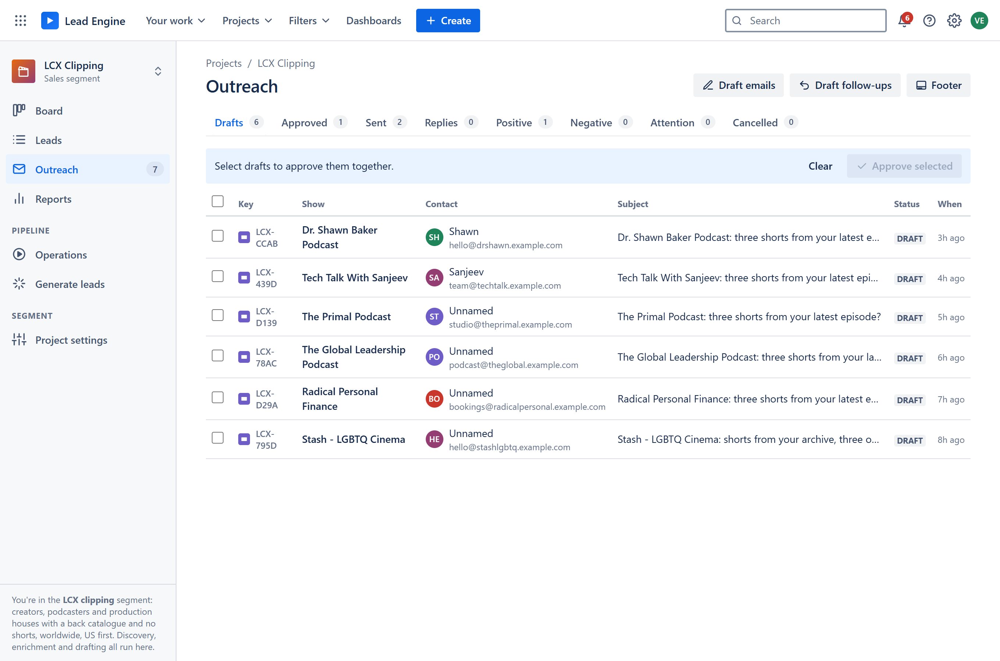{width=full}

| Folder | What is in it |
|---|---|
| **Drafts** | Written by the engine. Nothing has been sent. Waiting for you. |
| **Approved** | You said yes. It goes out at its own minute between 10:00 and 10:30 on its recipient's clock, inside the day's sending limit; **Goes out** says when. |
| **Sent** | Gone. |
| **Replies** | Every reply, with its mark: Positive, Negative, or Needs triage if nobody has judged it yet. |
| **Attention** | A send whose outcome is not known. Look at these. The folder shows only when something is in it. |

Each row shows the company (the show, in LCX Clipping), the contact, the subject
and when. In Approved the last column is **Goes out**: the day and minute it is
sent, on the recipient's clock ("Tue 10:17 New York"), with your own clock under
it when that is a third one; holding the mouse over it gives the whole sentence
and why that time zone. Approved is in that order, the next to go first. A
reply's mark sits in front of its subject.

Nothing here needs a button to get it going. A shortlisted lead's email is
drafted into Drafts within minutes, and in LCX Clipping a follow-up that falls
due is drafted into its own tab, **Follow-ups**, the same way. The one button at the top right, **Footer**, sets
the sign-off every email ends with.


# Approving one email

Click any row in Drafts. It opens beside the list, and **J** and **K** (or the
arrows at its top right) move through the folder. Moving never approves
anything: approving is always its own click, after reading. If you have edited a
draft, moving to another one or closing it asks first, so an edit is never lost
to a stray click.

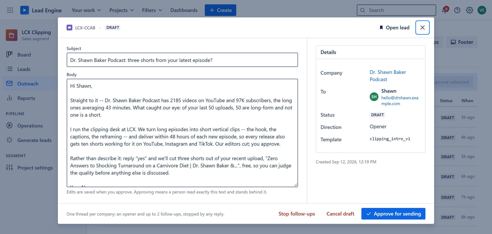{width=full}

The subject and the body are editable. Change anything you like: the whole point
is that what you approve is what goes out, word for word. On the right are the
company and the address it goes to.

Notice what is personal in it. The greeting is the first name of the person the
email goes to, never the show's or the company's name. In LCX Clipping the
opening sentence is their own numbers, and the offer names their actual most
recent episode. None of that was invented; all of it came from the evidence on
the lead. Internal research notes never go into an email.

Production-house emails follow the owner's template of 14 October, under the
subject "Stories built to travel": who we are and what TVF makes; "Which is why
<company> caught my attention.", one line about their work and the partnership
lines for the company's lane (animation, documentary, digital-first, drama or
general, the owner's own wording); a short call, "I am based in Mumbai and would
gladly work around your schedule." The approver speaks in their own name: "I'm
Kartikeya, who handles Business Development and IP Strategy at The Viral Fever
(TVF)…" for Kartikeya, and each other person's own first name and title for
them. It is signed "Regards, <name>. The Viral Fever". The line about their work
is written by a model (Groq) from what the company says about itself on its
website and nothing else, and it ends "…is the same ground our own series stand
on."; it never names the company, a person or anything that is not on record,
and with nothing of theirs on record a plain line stands in. With a named person
the email opens "Hello Kelly, I trust you are well."; with none, "Hello,".

Some drafts say **Written by a model** in their details: a model wrote the
opening sentence from that same evidence and nothing else, with every number in
it checked against the evidence before it was kept. A written draft is approved
on its own, never in a batch, because a random sample cannot stand for a
sentence written once for one company.

**CC.** Every email is copied to amritanshv@lightscameraexperiment.com unless you
switch that off: in the draft's details, under **CC**, untick the address. Type any
other address into the same box and press Enter to copy them in too; the × removes
one. Changes save at once. The list an email is approved with is the one it goes out
with, and the **Write email** box has the same switch.

**Approve** records your name against the email and sends it at its own minute
in the recipient's next 10:00–10:30 (the draft shows that window under **Next
window**, with why that time zone; the minute itself is drawn when you approve).
It is the only button on a draft. If you do not want to write to a company at
all, reject the lead: its draft goes with it.

**Withdraw approval**, on an approved email that has not gone yet, takes your
yes back. For a first email, as long as the lead stays shortlisted, a new one is
written and waits in Drafts. Withdrawing a follow-up ends the thread.

**Stop follow-ups** (LCX Clipping, on a sent email or a follow-up draft) ends
the whole thread with that company. No further follow-up will ever be drafted
for them.

## Approving sends

Approving is the decision to send, and in US Production Houses **it goes out from
your own Gmail**, signed with your own name and title. You connect it yourself
(account menu, Your Gmail; see *Getting in*). A person can have more than one. Each address sends **up to 50 a day**, and an approval goes
out from whichever of yours has the most room left. Nobody's approval ever
leaves from somebody else's address.

**What you see is what goes out.** A draft is shown to you as you would send it:
your name in the sign-off, and in US Production Houses your own first name and
title in the opening ("I'm Kartikeya, who handles Business Development and IP
Strategy…" when Kartikeya opens it). Approving stores exactly the text you read. Approving needs your name and title; if you
have not set them, it says so.

**Sending today**, at the top of Outreach, lists everyone: each of their sending
addresses with today's count out of its limit (for example `3/50`), anyone who
has none linked yet, and their approvals by the day each goes out ("approved: 3
on Tue 14 Oct, 2 on Wed 15 Oct", days on India's clock). The counts start again
at midnight UTC, which is 5:30 am in India. An approval by someone with no
Gmail waits in Approved until they connect one.

In the other projects the email goes out from the project's own mailbox, inside
the day's sending limit and each mailbox's warm-up, and the counter at the top of
Outreach shows how many have gone out today against that limit, and the approved
ones by the day each goes. Either way, never to an address that failed
verification.

## When an email goes out

The owner, 12 October: *"send mails to the sender's time region between 10 to
10:30AM and that must be randmized not like all mail going at 10:15 some must be
going at 10:17 some at 10:13"*. So every approved email goes out at **its own
minute between 10:00 and 10:30 on the recipient's clock**, Monday to Friday
there: 10:00 in Mumbai would be 5:30 in London, before anyone reads email. The
minute is drawn when you approve, and the email shows it as **Goes out**: "Tue 14
Oct, 10:17 New York time (19:47 IST)", the recipient's time first, India's in the
brackets.

Where the recipient is comes from what the lead holds: the person's own record,
the company's state or city, a phone's area code, its country. The reason sits
under *Goes out* ("company state TX (FDIC)"). A lead that names no place goes at
the project's own default (New York's 10:00 for LCX, Los Angeles' for US
Production Houses, India's for Universal).

Approve as many as you like. Two emails from one address are never sent closer
than 45 seconds apart, so one window holds about 24 per address per window; the
rest go in the next weekday's window, each at a new minute. An approval after
the day's window, or at a weekend, goes in the next weekday's. If an email's
window passes and it has not gone — the server was down, its address had used
up its 50 for the day, Gmail refused the address — it moves to its next window
at a new minute, never later the same afternoon, and says why: *Its earlier
window passed unsent (…): now Wed 15 Oct, 10:04 New York time*. Until a sending
address is connected (see *What only you can do*), approved emails wait in
Approved, and move from window to window until one is.

**One first email per inbox and per company.** An address that already has a
first email from us, under any lead in the project, is not written to again, and
neither is a company of the same name found under a second website. Approving
such a draft says why it cannot be approved; if two slip through together, the
second is held back at sending with the reason. That keeps the footer's promise:
"you won't hear from me again".

**When Gmail says no.** If Gmail refuses one email, it is held back in Approved
with Gmail's reason instead of being sent. If Gmail refuses the mailbox itself
(its sign-in has expired or been revoked, or a sending limit is hit), the email
goes back to Approved untouched, sending stops for that run, and Operations
shows the run as failed. After a sign-in problem, sign the mailbox in again (see
*What only you can do*) and approved emails go out on the next run.

**Sending is paused in LCX Clipping and Startup Acquisitions** (since 21
September): only US Production Houses sends for now. In those two projects you
can still draft and approve; approving says the email waits, and it stays in
Approved until the pause is lifted. The pause is a setting in each project's
config (`outreach.sending_paused`), so lifting it is a one-line change.


# Approving many at once

Reading six hundred emails one at a time is not realistic, so the app has a
second route that is still honest about what you read.

1. Tick the checkbox on each draft you want, or the one in the header to take
   one batch, the first 100 drafts. Untick the header box to clear the
   selection.
2. A bar appears at the top. Press **Approve N selected**.
3. The server picks a random sample from your selection and shows you those.

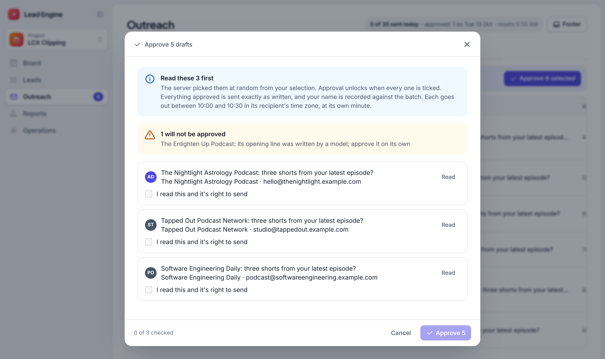{width=full}

You have to read each one in the sample and tick it before the Approve button
turns on. The sample is at least three, or one in ten, whichever is bigger, and
you cannot choose which ones you get. Every email in the batch is checked first
for unfilled placeholders, a missing sender, a bad address or a company that has
moved on; anything that fails is left behind and named.

Afterwards, each email records your name, the batch it belonged to, and whether
it was one of the ones you actually read.

Batch approval is on for LCX Clipping only. The TVF projects still require one
approval per email.


# The footer

The sign-off is the same on every email of a project. It is one setting, not
lines buried in each template. Since 2026-10-13 no project's footer has an
opt-out line or a postal address (the owner: "remove the last line from every
single service"); any reply that is not neutral still stops all mail to that
address. In LCX Services, LCX Clipping, US Production Houses and Universal the
email is signed with the name and title of whoever approves it.

Press **Footer** at the top of the Outreach screen.

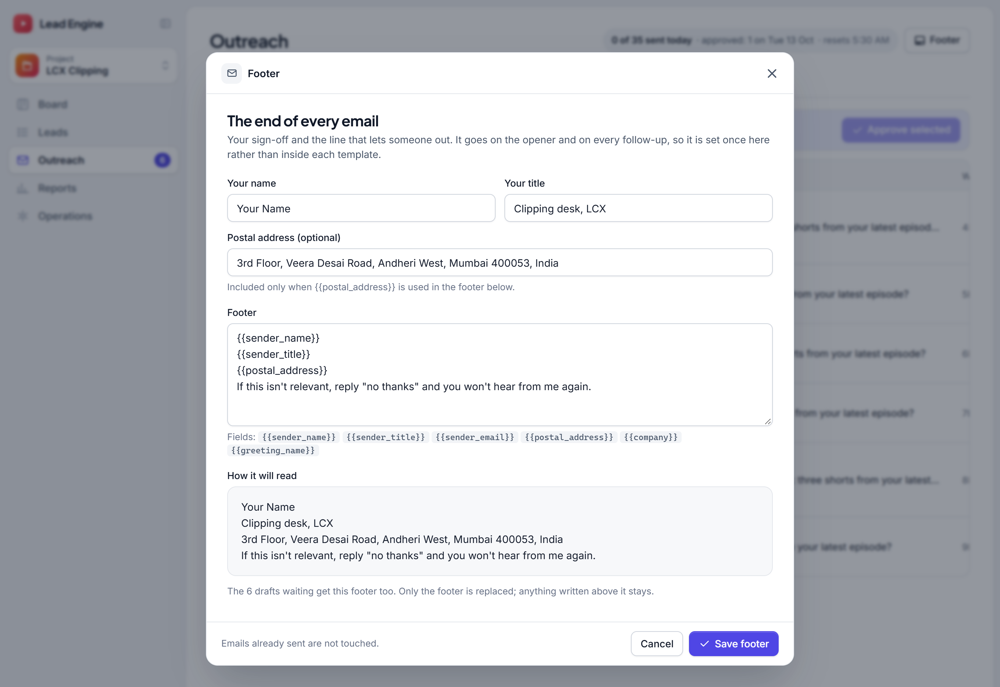{width=full}

Fill in your name, your title and your postal address. In the footer text,
`{{sender_name}}`, `{{sender_title}}` and `{{postal_address}}` stand for those
three. The preview underneath shows exactly how the block will read.

It will not let you save an empty footer, one that still says `SET_ME`, or one
with a field it does not know.

**Subjects** are five words at most in every project except Universal, where
you write your own. A subject that would come out longer is replaced by the
template's short fallback, and a stored one that is longer cannot be approved.

When you save, the drafts already waiting for approval get the new footer too.
Only the footer is replaced; anything you wrote by hand above it stays exactly
as you wrote it. Emails already sent are never touched.


# Follow-ups

In every project, one company gets one thread: the first email, then one
follow-up in the same email thread, **four days after the first email went out**
with no reply (since 23 October). It goes from the same address, as
"Re: <the first email's subject>", signed by the person who sent the first
email. Then the thread is closed for good.

Follow-ups wait in their own tab, **Follow-ups**, next to Drafts (which holds
first emails only). Approve them there, one at a time or in a batch. Once
approved they are in Approved, and once sent in Sent, marked as a follow-up.

**Any reply stops it immediately.** A genuine reply ends the thread; an
out-of-office lets it resume. This is enforced in the database, not just in the
app, so a follow-up cannot be sent to someone who has already written back even
if something else goes wrong.

Follow-ups are drafts like any other email and need the same approval. They are
drafted by themselves when they fall due; read and approve them like any other.

To stop a thread by hand, open its sent email, or a follow-up waiting in
Follow-ups, and press **Stop follow-ups**. Rejecting the lead stops it too.

Each project has its own follow-up wording. LCX Services' names the service its
first email pitched; Universal's, whose first emails people write themselves,
says only what fits any of them.


# Replies

When someone writes back, their reply appears in **Replies** within the hour:
the engine reads each sent thread's mailbox hourly, by itself. It only reads; a
bounce ("address not found") marks that address so nothing is written to it
again. Open a reply.

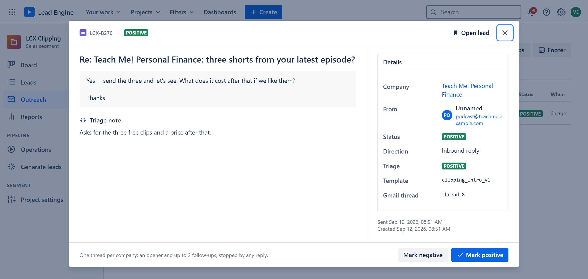{width=full}

You mark it **Positive** or **Negative**. The reply stays in Replies either way,
with its mark in front of the subject; one nobody has marked yet says **Needs
triage** and counts in the number next to Outreach.

Positive moves the company to **In conversation** on the board and hands it to
you. Negative closes it out. Either way the follow-up thread stops.

If an Anthropic key is configured, a triage step reads new replies first and
suggests a label with a one-line reason. It is a suggestion. Your click is what
counts.

A bounce (a mailer-daemon reply) is handled without you: the address is marked
invalid, the thread ends, and no mailbox writes to that address again.

## In conversation

The tab after Replies lists the companies we are talking to: one row per company
that has written back with a real reply. An auto-reply or a bounce notice
doesn't count. Each row shows:

- their latest reply;
- who on our side reached out;
- how many messages the thread has.

A company leaves the list when its latest reply is marked Negative (not
interested), or when the company is rejected. A newer reply from the same
company replaces the row, so each company appears once. Open a row to read the
reply and mark it.


# Operations

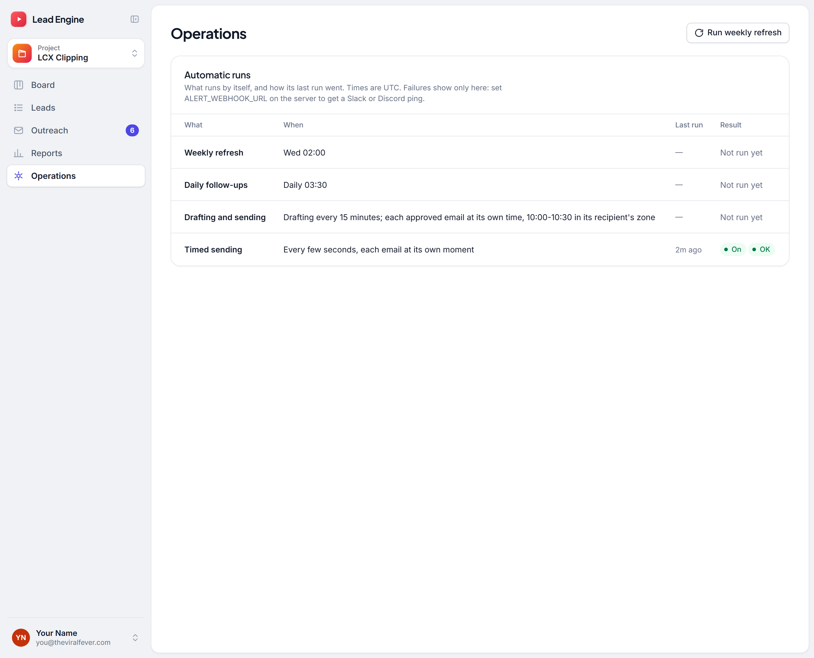{width=full}

## Running the refresh by hand

There is one button: **Run weekly refresh**. It runs this project's weekly
refresh now instead of waiting for its day. The refresh finds new candidates (in
LCX Clipping and Startup Acquisitions), fills in what is missing (the contact
address, the website, the evidence the scoring needs), then scores everything
again and applies the gates. Its steps run one at a time.

In **US Production Houses** one of those steps asks Apollo. Every company scoring
**over 22.5** with nobody to write to gets one free search on its domain for the
roles that project targets, and the best person's work address costs one credit.
A company with no website is first looked up in Apollo by its exact name (one
credit), and only a single exact match is trusted. Companies at 22.5 or below are
not paid for. The address also
counts toward the score: a named person is worth the rubric's 10 points for a
reachable decision-maker, and the lead is re-scored as soon as it is found. A run
stops at 150 credits, shortlisted leads are served first, and a company Apollo
does not know is left for a month. No other project spends a credit: that is a
setting in the project's own config, and it is on for this one only.

You do not normally need it. The schedule runs it for you once a week. Use it
when you want more leads today, or when you have changed something and want to
see the effect now.

Only one refresh runs at a time: a second click while one is running is refused.

Whenever something is running, its log streams at the bottom of the page, with
a **Stop** button. A send has no Stop button: it stops only by finishing.

## Automatic runs

One row for each thing that runs by itself, with when it runs (in UTC), when it
last ran ("by hand" if a person started it) and how that went:

- **Weekly refresh**: Tuesday 02:00 for US Production Houses, Wednesday 02:00
  for LCX Clipping, Thursday 02:00 for Startup Acquisitions.
- **Drafting and sending**: drafting every 15 minutes, when there is work; each
  approved email at its own time, 10:00–10:30 in its recipient's zone.
- **Timed sending**: whether the server's timed sender is **On**, and how its
  last run went. If it says **Off**, hold the mouse over it for why: approved
  emails then go only every 15 minutes and most move to the next weekday.
- **Gmail refused an address**: shown only when Gmail turned one of the
  sending addresses away in the last day, with which one and why. Its emails
  have moved to their next window and the other addresses carry on; tell the
  owner if it shows day after day.

A failed run says which step failed; hold the mouse over it to read the error.
If no alert webhook is set up, the panel says that failures show only here.

## Mailboxes

This panel appears only in projects with several mailboxes (LCX Clipping). It
shows each sending address, how much it can send today, how much it has already
sent, and how much room is left. A mailbox that is not connected yet says what
to set.

New mailboxes **warm up**: ten emails a day to start, five more every two days,
up to forty. Three warm mailboxes give 120 a day, which is also the project
ceiling. This is not caution for its own sake; a new address that sends eighty
cold emails on day one gets filtered, and then none of them arrive.

Openers are spread across whichever mailbox has the most room. A follow-up always
leaves from the mailbox that sent its opener, because a thread belongs to one
mailbox.


# Reports

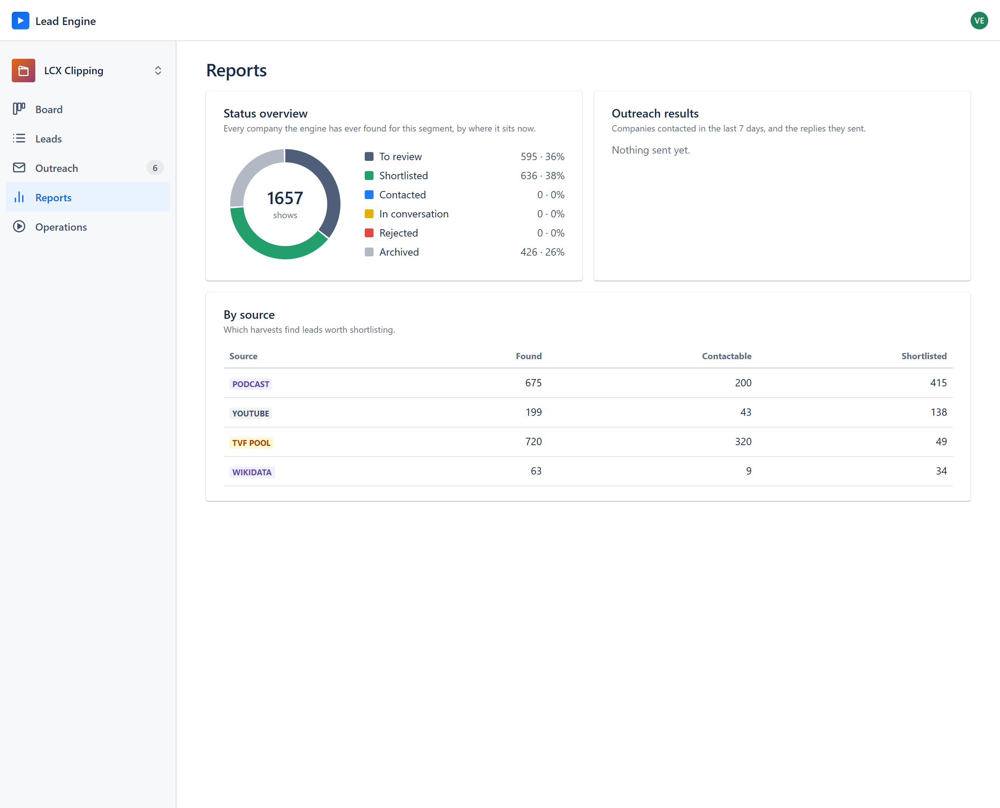{width=full}

**Status overview** — every company ever found for this project, and where it
sits now.

**Outreach results** — says "Nothing sent yet." until the first email goes out.
Then: the companies contacted in the last 7 days (follow-ups not counted), the
reply rate and the positive rate, and in LCX Clipping the follow-ups sent. The
target is 15 to 20 companies contacted a week.

**Team** — what each person sent, and how it was answered. Pick the span along
the top: **Today** (since midnight, India's clock), **7 days**, **30 days**, **90
days** or **All time**. Then pick **All projects** or **This project**. The page
remembers both on your browser. Everyone with a login has a row, including
someone who sent nothing. For each person:

- **Sent:** first emails that went out in that span, one per company, credited to
  whoever approved them (their Gmail, their name). With All projects, the
  projects they went to are listed under the name.
- **Follow-ups:** follow-ups that went out, credited to whoever's thread it is.
- **Replied** and **Reply rate:** how many of those companies wrote back, at any
  time since. An auto-reply or a bounce notice is not a reply.
- **Positive:** the replies marked positive.
- **Bounced:** emails whose address rejected them, with the rate.
- **Typical reply:** the usual time from a first email to its reply.
- **Waiting to go:** approved now, waiting for its time.
- **Per day** (or **Per week** for the long spans): a bar for each, with the count
  on hover.

**Everyone** at the bottom adds them all up. The same name shows in the Sent
folder's **By** column, under **Contacted** in the leads list, on the board
card, and in the lead's own **Outreach** box, with the address it went out from.

**By source** — which connectors are earning their place: for each one, how
many companies it found, how many can be contacted, and how many were
shortlisted. It shows only in projects with more than one source.

The Universal project has no Reports page.


# The API and MCP

The Lead Engine can also be used from another program, or from an AI assistant such as Claude, as you.

- **claude.ai** needs no key. In claude.ai, open Settings, then Connectors, then Add custom connector, and paste
  `https://tvf-lead-engine.onrender.com/mcp`. Then connect, log in to the Lead Engine if it asks, and **Allow**.
- **Anything else** (Claude Code, Claude Desktop, a program) uses a key. In the account menu, **API and MCP** makes
  one. The key is shown once: copy it and keep it like a password. The same window shows how to connect each, with
  your key filled in.

A key, or a connected app, works as you. It can:

- read projects, leads and emails;
- add a lead you found, with its email as a draft;
- shortlist or reject a lead;
- change or withdraw a draft;
- approve an email, if you allowed that when you made the key or connected the app.

Approving through it is the same as pressing Approve here. The email is sent from your Gmail, signed by you, at its
time, and shows "approved through the API or an assistant". **Revoke**, or **Disconnect** for a connected app, stops
it straight away (within half a minute everywhere). The full reference, every call and every tool, is in
`docs/api.md`.


# The rules that never bend

These are built into the database, not just into the screens. They hold even if
the app has a bug.

**No email is ever sent that nobody approved.** Approving is what sends it,
and every approval is recorded against a person. Usually that person read the
exact text here. It can also be an assistant or program using a key or
connection that the person allowed to approve (*The API and MCP*). That is
recorded as such, and passes the same checks. There is no "approve all without
looking". Nor does an approved email go outside its own window: the database
refuses that too.

**One thread per company, ever.** A first email and one follow-up. Checked
across every project, not just the one you are in, and it survives resets and
re-imports.

**A rejected lead never comes back.** No later harvest will re-import something
you turned down. Only a person can bring one back, by adding it by hand and
writing to it (*Adding a lead you found*), and the page says so before anything
is approved.

**"Remove me" is permanent.** An opt-out request marks that domain unsubscribed
forever.

**Nothing is claimed that the evidence does not support.** Every sentence in an
email is built from that lead's own recorded numbers. A lead that already
publishes shorts gets no "you publish no shorts" line, because it would not be
true of them.

**Only public first-party pages are read, and robots.txt is honoured.** No
LinkedIn scraping. No CAPTCHA bypass. No buying scraped lists.

**Credits are spent only where you turned them on.** Apollo costs money per
person revealed, so a project spends nothing unless its own config says it may.
US Production Houses may; LCX Clipping, Startup Acquisitions and Universal's
automatic steps may not. Searching costs nothing anywhere, and on the Universal
page you see what a save will cost before you agree to it.


# What only you can do

The engine cannot finish these. Each one needs a person with an account or a
card.

**1. Fill in the footer.** Your name and postal address, in the Footer dialog on
the Outreach screen. Until this is done, no email can be approved: the check
refuses a draft that still says `SET_ME`.

**2. Link each person's sending address (US Production Houses).**
`python tools/users.py gmail <their login>` on your machine, once per address
(see *Getting in*). It uses the Google client already in `.env`, and nothing
needs adding to Render. Because the consent screen is **Internal**, only
theviralfever.com addresses can be linked. If a sending address's sign-in stops
working (a password change, access removed), Sending today marks it, its
emails wait, and running the same command again fixes it.

**3. Connect a project mailbox (LCX Clipping).** A Gmail OAuth client in Google
Cloud, then the address in `.env`, then one browser consent per mailbox:

```
SEGMENT_SLUG=lcx-clipping python tools/outreach.py auth --mailbox main
```

Sending happens on the server, so put the same values in Render's Environment
tab: the address, the Google client ID and secret, and the token that `auth`
wrote (the variable name is listed by `python tools/outreach.py mailboxes`).

Use addresses on a sending domain that belongs to LCX alone, not the main company
domain, so a bad week never touches everyday mail.

**4. Connect Apollo**, for the Universal project and for the addresses the
weekly refresh buys in US Production Houses. In Apollo: Settings → Integrations
→ API Keys → Create new key, tick the five endpoints the Apollo search page
lists (or turn on *Set as master key*), then put the key in `.env` as
`APOLLO_API_KEY` and in Render's Environment tab. Until then the page shows
these steps at the top, and the refresh's Apollo step finds no key and stops
short of spending anything.

**5. Put the YouTube key on the server.** In Render's Environment tab, set
`YOUTUBE_API_KEY` (the same Google key as in `.env`). Without it, LCX Clipping's
weekly refresh stops at its YouTube step. It has failed that way since
2026-09-16, and Operations shows it under Automatic runs.

Optional, and worth having later: an Anthropic key for reply triage, and an alert
webhook so a failed overnight run reaches you.


# If something looks wrong

**"I approved it but nothing was sent."** It goes at its own minute in its
recipient's next 10:00–10:30: look at **Goes out** in Approved. If that time
has passed and it is still there, it has moved to its next window, and the
email says why (no mailbox connected yet, see *What only you can do*; or its
address's limit for the day was used up). A send the checks refused stays in
Approved, with the reason under its subject. A send whose outcome is not known
is in Attention.

**"The screen is blank / says it cannot reach the database."** The free cloud
instance goes to sleep when it is idle and takes a few seconds to wake. Reload
once. If it persists, check Operations for a failed run.

**"A lead has no contact."** The engine only uses addresses that companies have
published themselves. If nobody published one, open the lead: **Contacts** shows
every other way in it found (a phone number, the contact page, social profiles)
and what it already tried. The weekly refresh reads the website of every lead
without a usable address once, shortlisted leads included.

**"The greeting says 'Hi there' or just 'Hello,'."** (LCX Services never says
"Hi there": it is "Hello <first name>," or "Hello,".) That means no person could be
named for the address the email goes to, and the engine will not guess. When the
lead lists a person at their own address, or a person against a shared inbox
like info@, the greeting uses their first name. "Hi there" is correct behaviour;
"Hi Tech Talk" would not be.

**"A draft will not approve."** The dialog names the reason: an unfilled
placeholder, a sender that still says `SET_ME`, an address that failed
verification, or a company whose status has moved on since the draft was written.

**"I rejected something by mistake."** Leads list, Status set to Rejected, open
it, and press **Undo decision**. It goes back to To review.

**"Operations says the weekly refresh failed."** The row names the step it
stopped at; hold the mouse over it to read the error. If LCX Clipping's refresh
failed at its YouTube step, the server has no YouTube key yet (see *What only
you can do*).


# Words used here

**Project (segment)** — one sales motion with its own leads, rubric, templates
and mailboxes. Switch with the project name at the top of the sidebar.

**Lead** — one company, show or creator.

**Fit score** — out of 100: the points earned out of the rubric's 110, scaled to
100, plus adjustments. Every point is explained in the
lead dialog, along with the points nobody has checked yet.

**Gate** — a hard disqualifier. Fires only on confirmed evidence, never on
something the engine failed to check.

**Evidence** — a fact the engine actually observed, with a record of where it
came from.

**Draft** — an email that has been written and not sent. Inert until approved.

**Opener** — the first email to a company. **Follow-up** — a later one in the same
thread.

**Spot check** — the random sample the server makes you read before approving a
batch.

**Warm-up** — the ramp on a new mailbox, from ten a day up to forty.

**Enrichment** — the passes that fill in contacts and evidence on leads already
found.
